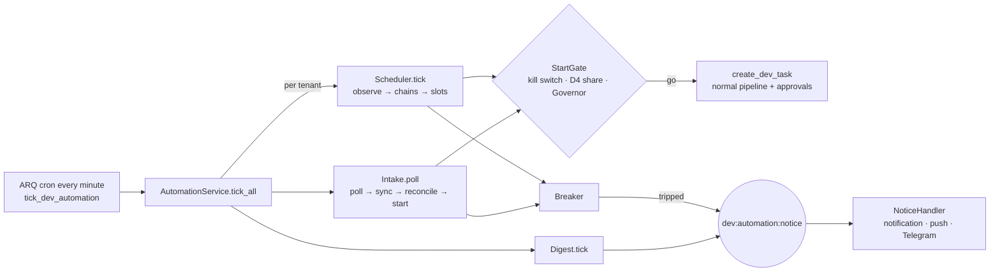

# Dev Automation — Intake, Schedules, Circuit Breaker, Morning Digest — Feature Spec

> **Status: Built, fixture-tested.** Phase 4a of the race-app migration (branch
> `race/automation-intake`). Migration `066_dev_automation`; code
> `life_graph/services/dev/automation/` (`settings`, `clock`, `sources`, `intake`,
> `scheduler`, `breaker`, `status`, `digest`, `store`, `wiring`, `service`),
> `life_graph/api/dev_automation.py`, `life_graph/workers/dev_automation.py` (per-minute
> ARQ cron), model module `life_graph/models/dev_automation.py`. Unit-tested with in-memory
> fakes of every port (no network, no database); **not yet run against Postgres or a
> signed-in `gh`**. Everything is **off by default** except the circuit breaker, which only
> ever stops automatic starts. For what the code does now, [docs/STATE.md](../STATE.md) is
> authoritative.

> **Purpose**: work *arrives* by itself (intake sources → a backlog → dev tasks), *runs on a
> schedule* (dev-task jobs and chains), *stops* when it keeps failing the same way (circuit
> breaker), and the owner hears about it once a day (morning digest) — without any of it
> approving, publishing or merging anything.
>
> **Rebuilt from** race-app's cockpit (`docs/specs/TEAMWORK.md` §5–6, `packages/shared-types/src/automation.ts`
> + `teamwork.ts`, `services/gateway/src/automation/{intake,schedule,breaker,digest}/**`), idiomatically:
> state in Postgres rows with database-enforced claims, the loop as an ARQ cron
> (CHARTER invariant 3), notices on the EventBus, life-graph intentions read natively.
>
> **Multi-tenant**: every table carries `tenant_id`; every statement filters by it.

---

## Invariants this keeps

| CHARTER | How |
|---|---|
| 1 LLM as advisor | No model call anywhere here: polling, dedupe, matching, normalising, digest are plain code. |
| 3 Event-driven | The loop is the `tick_dev_automation` ARQ cron; notices are `dev:automation:notice` events handled by `NoticeHandler`. |
| 4 Tenant-scoped | All six tables have `tenant_id`; the store's every statement filters by it (unit-asserted). |
| 5 Fail-closed | Every automatic start asks the start gate; any error in it refuses. The Governor's own fail-open answer is treated as a refusal. Nothing approves: tasks end in the normal `driver_pr` / `driver_plan` approvals. |
| 7 Personal data local | Only intentions the owner explicitly tagged for dev work are read; secrets are redacted (`services/redaction.redact`); the default persona is `code-fixer-local`. |

---

## Requirements

### Story 1: Intake → backlog

- GIVEN a source `{kind, projectId, filter?, persona?, mode, enabled, pollMinutes (5–1440, default 30), commentOnIssue (default false), name?}` WHEN it is enabled and due (`pollMinutes` since its last poll; all enabled sources on "poll now") THEN it is polled read-only:
  - `github_issues`: `gh issue list --label <filter|"life-graph"> --state open --limit 50 --json number,title,body,url` in the project's path → key `github:<owner/repo>#<n>`.
  - `failing_ci`: `gh run list --branch <base> --status failure --limit 10`, the **newest failure per workflow**, body = the failed jobs' log tail (`gh run view <id> --log-failed`, last 80 lines / 5000 chars) → key `ci:<run id>`, title `Fix failing CI: <workflow>`.
  - `life_graph_intentions`: the tenant's `intentions` rows with status `pending` / `triggered`, read from the table (no HTTP hop), matching when `context_match.project` names the project (id or name), `context_match.tags` contains the tag (`filter`, default `dev`), or the text has `#<tag>` → key `lg:intention:<id>`; text redacted.
  - `todo_comments`: `git grep -n -I -F -e "<marker>:" <base> --` on the base branch's tree (not the working copy; marker = `filter`, default `TODO(race)`; placeholders `…` / `...` skipped; ≤ 50) → key `todo:<path>:<line>:<sha1(line)[:10]>`.
  - base branch = project `scan_metadata.base_branch`, else `git_branch`, else `main`.
- GIVEN a candidate WHEN its key is already in `dev_backlog` for the tenant (any status, even after the item was skipped/done/failed, even if its source was deleted) THEN it is **never added again** (`UNIQUE (tenant_id, external_key)`, `INSERT … ON CONFLICT DO NOTHING`).
- GIVEN a `failing_ci` candidate WHEN an item of that source with the same title (`Fix failing CI: <workflow>`) is still `new`/`queued`/`running` THEN it is not added (one open item per workflow).
- GIVEN a poll fails (command error, timeout, invalid JSON, project gone) THEN it is logged and stored on the source (`lastError`), the other sources still run, nothing is started for it.
- GIVEN `new` items WHEN the tick starts work THEN at most `maxConcurrent − (items queued/running)` and `maxPerDay − (items started since tenant-local midnight)` are started, oldest first, skipping sources whose breaker is tripped, and only when the **start gate** returns no reason. An automatic start queues the task (`start=False`: unattended, so the dispatcher's own budget checks apply again when it runs).
- GIVEN an item is started THEN it is claimed first (`status new|failed|skipped → queued` compare-and-set, `started_at`, `properties.started_by`) and a dev task is created through `create_dev_task` with `properties.origin = "intake"`, `properties.automation = {kind: "intake", source_id, backlog_id, external_key, mode}`, the source's persona (default `code-fixer-local`), and the mode: `plan` → a plan task (`task_type plan`, `spec_first`, `verify_chain ["no_diff_in_plan"]`); `ask` and `auto` → a normal code task (whether anything is auto-approved is decided by the autonomy policy, never by intake). The task's instruction is title + body + `Source: <url>` + "Make a focused change; keep it minimal; make the tests pass." (≤ 8000). A start that throws marks the item `failed` (reason) and counts for the breaker.
- GIVEN items `queued`/`running` WHEN the tick syncs THEN each takes its status from its task: `queued`/`parked` → queued; `running`, or finished and waiting for the owner (`awaiting_pr`, `pr_open`, `awaiting_merge`, `needs_review`, a pending plan) → running; `merged`, `landed`, a plan approved (`completed`) → `done`; failed / cancelled / `pr_rejected` / `closed` / task gone → `failed` (with a reason; restartable). Each outcome also feeds the source's breaker.
- **Reconcile** GIVEN a source polled this round WHEN an item of it has a task still queued/running/parked AND the issue is closed (`gh issue view <n> --repo <r> --json state` = `CLOSED`) / the TODO (path + line hash, line moves ignored) is gone from the base branch / a newer run of the workflow passed on the base branch (`gh run list --workflow <w> --status success --limit 1` id > the item's run id) / the intention is no longer active THEN the task is cancelled (`request_cancel`) and the item marked `skipped` with the reason. A lookup that fails leaves the item alone.
- GIVEN `commentOnIssue: true` on a `github_issues` source THEN one comment each is posted when the item is picked up, when its PR exists, and when it is done (each stage recorded **before** posting, so a failure never repeats it). Off by default: intake is otherwise read-only.
- **Owner actions**: "Start now" (`new`/`failed`/`skipped`) ignores `maxConcurrent`, `maxPerDay` and a tripped breaker, starts at once (interactive, `requested_by` recorded), and is refused only by the kill switch (409), an unknown item (404) or a source that no longer exists (409). "Skip" works on `new`/`failed` items only (queued/running ones are reconciled, not skipped).

### Story 2: Dev-task schedules and chains

- GIVEN a job `{name, projectId, instruction (5–8000), persona?, mode, days (0–6, Sun–Sat), time "HH:MM", enabled, after?}` WHEN the tenant-local day is one of `days` and the local time has reached `time` THEN it starts **once per job per local day** (`dev_schedule_runs` claim, partial unique index `(schedule_id, slot_date) WHERE trigger='scheduled'`), even across restarts and overlapping ticks. Timezone = the settings' `timezone`, else `LIFE_GRAPH_USER_TIMEZONE`, else UTC.
- GIVEN the worker was down WHEN the slot is ≤ 120 min late THEN it is caught up (yesterday's slot too, e.g. 23:30 at 00:20); > 120 min → recorded `missed`, never run.
- GIVEN a DST change THEN once-per-day is keyed on the local date and "time passed" compares wall-clock minutes: a slot in the skipped spring-forward hour runs at the first minute after it; the repeated fall-back hour never runs it again.
- GIVEN a slot is due WHEN the kill switch is on / the job's breaker is tripped / the job's previous task is still queued, running or parked / the start gate refuses THEN the slot is recorded `skipped_kill_switch` / `skipped_breaker` / `skipped_overlap` / `skipped_budget` with the reason and not retried that day.
- GIVEN `after = <job id>` THEN days/time are ignored; WHEN the predecessor job's latest run task **finished its work** (status `completed`, stage `awaiting_pr`, `pr_open`, `awaiting_merge`, `merged`, `landed`, `completed`, or a filed plan) and that run is < 24 h old THEN the chained job starts **once per predecessor task** (partial unique index `(schedule_id, predecessor_task_id) WHERE trigger='chain'`), with `properties.automation.after_task_id`. WHILE it would be refused (kill switch, breaker, overlap, gate) nothing is claimed: the chain is **held** and retried every tick inside the 24 h window. A failed predecessor never triggers it.
- GIVEN a save WHEN `after` names the job itself, an unknown job, or forms a loop THEN the save is refused (400). Draft (non-UUID) ids in a save get UUIDs and `after` references to them are translated.
- "Run now" starts the job at once (interactive), recorded as a `manual` run; bypasses the breaker and the budget; refused (409) by the kill switch or an overlapping run; 404 for an unknown job.
- Tasks: `properties.origin = "schedule"`, `properties.automation = {kind: "schedule", job_id, run_id, mode, after_task_id?}`; mode as in Story 1.

### Story 3: Circuit breaker

- Keys `intake:<sourceId>` and `schedule:<jobId>`. Settings `breaker {enabled (default **true**), threshold (2–10, default 3)}`.
- GIVEN a task of that key fails (status `failed`, reason = its error; or stage `needs_review` = checks failed twice, not a pending plan) or a start throws THEN the reason is **normalised** (ISO times / clock times → `<time>`, UUIDs, prefixed ids, 7+ hex → `<id>`, paths → `<path>`, digits → `#`, whitespace folded, ≤ 300) and: same as the last reason → count + 1; different → count 1. Each task is counted once (`counted`, newest 50).
- GIVEN the count reaches the threshold THEN the key **trips** (`tripped_at`), automatic starts for it stop, and a notice is published once: title `Automation paused: <label> — <reason>` (label = the source's name, else `<Kind> · <project>`; the job's name), as a notification (priority `important`), Web Push and Telegram.
- GIVEN a success (the task finished its work, e.g. after a manual "Start now"/"Run now") THEN the count resets and the key un-trips. A cancelled task counts neither way.
- GIVEN `POST …/breakers/{key}/reset` THEN count 0, not tripped (404 for an unknown key).
- GIVEN `enabled: false` THEN nothing is recorded and nothing is tripped.

### Story 4: Morning digest

- GIVEN `digest {enabled (default **false**), time "HH:MM" (default 08:00)}` WHEN the tenant-local time reaches `time` THEN the night-shift report (`services/night_shift.report` + `lines`) for the window since the previous digest (else the last 24 h) is built, today's date is claimed in `dev_automation_settings.state` (once per local day; a worker started late sends that day's digest late, once), and unless it was a quiet night (no lines: nothing merged, waiting, failed or queued) it is published as `dev:automation:notice` (`kind: digest`): a notification, Web Push (`/m`) and Telegram. Title `Night shift: <head line>`, body the head line + up to 20 lines. Replaces race-app's digest.
- `GET …/digest/preview` builds the same for now without recording or sending.

---

## Design



### Start gate (every automatic start; `wiring.StartGate`)

1. Kill switch: `autonomy_stopped(tenant)` → "Autonomy is paused (kill switch)…".
2. The persona's driver (`persona.driver`); none → refused.
3. Subscription share (risk D4): `accounts_hook.preview(driver, tenant, unattended=True)` — `over_budget` (every account over `driver_accounts_subscription_max_share`), `cooling`, `error` → refused. Off when `driver_accounts_enabled` is false.
4. Governor for api-billed runs (not when the preview picked a subscription account): `governor.authorize(tenant, DRIVER, 0, interactive=False)`; refused when not allowed, **and when it failed open**.
5. Any exception → refused ("The start gate could not be checked: …").

Manual starts check the kill switch only (interactive work is never Governor-blocked, as everywhere else).

### Concurrency

The cron takes a session advisory lock (`pg_try_advisory_lock(hashtext('dev_automation_tick'))`); a long tick makes the next one skip. Within and across processes the claims are database-enforced: backlog keys (unique), item transitions (conditional `UPDATE … WHERE status IN (…) RETURNING`), slots and chains (partial unique indexes), the digest day (conditional update of `state`), breakers (`SELECT … FOR UPDATE`). An owner "poll now" during a tick may at worst start one item over `maxConcurrent`.

### SQL (migration `066_dev_automation`)

```sql
CREATE TABLE dev_automation_settings (
    tenant_id VARCHAR(64) PRIMARY KEY,
    settings JSONB NOT NULL DEFAULT '{}',   -- intake limits, digest, breaker, timezone
    state JSONB NOT NULL DEFAULT '{}',      -- digest_date, digest_to (written by the automation)
    updated_by VARCHAR(128),
    created_at TIMESTAMPTZ NOT NULL DEFAULT now(),
    updated_at TIMESTAMPTZ NOT NULL DEFAULT now()
);

CREATE TABLE dev_intake_sources (
    id UUID PRIMARY KEY DEFAULT gen_random_uuid(),
    tenant_id VARCHAR(64) NOT NULL,
    kind VARCHAR(32) NOT NULL
        CHECK (kind IN ('github_issues','failing_ci','life_graph_intentions','todo_comments')),
    name VARCHAR(80),
    project_id UUID NOT NULL,
    filter VARCHAR(100),
    persona VARCHAR(100),
    mode VARCHAR(8) NOT NULL DEFAULT 'ask' CHECK (mode IN ('plan','ask','auto')),
    enabled BOOLEAN NOT NULL DEFAULT false,
    poll_minutes INTEGER NOT NULL DEFAULT 30 CHECK (poll_minutes BETWEEN 5 AND 1440),
    comment_on_issue BOOLEAN NOT NULL DEFAULT false,
    last_polled_at TIMESTAMPTZ,
    last_error TEXT,
    created_at TIMESTAMPTZ NOT NULL DEFAULT now(),
    updated_at TIMESTAMPTZ NOT NULL DEFAULT now()
);
CREATE INDEX ix_dev_intake_sources_tenant ON dev_intake_sources (tenant_id);

CREATE TABLE dev_backlog (
    id UUID PRIMARY KEY DEFAULT gen_random_uuid(),
    tenant_id VARCHAR(64) NOT NULL,
    source_id UUID REFERENCES dev_intake_sources(id) ON DELETE SET NULL,
    external_key VARCHAR(300) NOT NULL,
    title VARCHAR(300) NOT NULL,
    body TEXT,
    url TEXT,
    status VARCHAR(16) NOT NULL DEFAULT 'new'
        CHECK (status IN ('new','queued','running','done','skipped','failed')),
    task_id UUID,
    reason TEXT,
    started_at TIMESTAMPTZ,
    properties JSONB NOT NULL DEFAULT '{}',  -- comments[], started_by
    created_at TIMESTAMPTZ NOT NULL DEFAULT now(),
    updated_at TIMESTAMPTZ NOT NULL DEFAULT now(),
    CONSTRAINT uq_dev_backlog_tenant_key UNIQUE (tenant_id, external_key)
);
CREATE INDEX ix_dev_backlog_tenant_status ON dev_backlog (tenant_id, status);

CREATE TABLE dev_schedules (
    id UUID PRIMARY KEY DEFAULT gen_random_uuid(),
    tenant_id VARCHAR(64) NOT NULL,
    name VARCHAR(80) NOT NULL,
    project_id UUID NOT NULL,
    instruction TEXT NOT NULL,
    persona VARCHAR(100),
    mode VARCHAR(8) NOT NULL DEFAULT 'ask' CHECK (mode IN ('plan','ask','auto')),
    days INTEGER[] NOT NULL,                 -- 0-6 = Sunday-Saturday
    time VARCHAR(5) NOT NULL,                -- tenant-local HH:MM
    after_id UUID REFERENCES dev_schedules(id) ON DELETE SET NULL,
    enabled BOOLEAN NOT NULL DEFAULT false,
    created_at TIMESTAMPTZ NOT NULL DEFAULT now(),
    updated_at TIMESTAMPTZ NOT NULL DEFAULT now()
);
CREATE INDEX ix_dev_schedules_tenant ON dev_schedules (tenant_id);

CREATE TABLE dev_schedule_runs (
    id UUID PRIMARY KEY DEFAULT gen_random_uuid(),
    tenant_id VARCHAR(64) NOT NULL,
    schedule_id UUID NOT NULL REFERENCES dev_schedules(id) ON DELETE CASCADE,
    slot_date VARCHAR(10) NOT NULL,          -- tenant-local YYYY-MM-DD
    trigger VARCHAR(16) NOT NULL,            -- scheduled | chain | manual
    predecessor_task_id UUID,
    outcome VARCHAR(32) NOT NULL,            -- starting|started|missed|failed|skipped_*
    task_id UUID,
    detail TEXT,
    created_at TIMESTAMPTZ NOT NULL DEFAULT now(),
    updated_at TIMESTAMPTZ NOT NULL DEFAULT now()
);
CREATE UNIQUE INDEX uq_dev_schedule_runs_slot
    ON dev_schedule_runs (schedule_id, slot_date) WHERE trigger = 'scheduled';
CREATE UNIQUE INDEX uq_dev_schedule_runs_chain
    ON dev_schedule_runs (schedule_id, predecessor_task_id) WHERE trigger = 'chain';
CREATE INDEX ix_dev_schedule_runs_job ON dev_schedule_runs (tenant_id, schedule_id, created_at);

CREATE TABLE dev_automation_breakers (
    id UUID PRIMARY KEY DEFAULT gen_random_uuid(),
    tenant_id VARCHAR(64) NOT NULL,
    key VARCHAR(120) NOT NULL,               -- intake:<sourceId> | schedule:<jobId>
    label VARCHAR(120) NOT NULL,
    tripped BOOLEAN NOT NULL DEFAULT false,
    consecutive_failures INTEGER NOT NULL DEFAULT 0,
    last_reason TEXT,
    tripped_at TIMESTAMPTZ,
    counted JSONB NOT NULL DEFAULT '[]',     -- task ids already counted (newest 50)
    updated_at TIMESTAMPTZ NOT NULL DEFAULT now(),
    CONSTRAINT uq_dev_automation_breakers_key UNIQUE (tenant_id, key)
);
```

No change to `agent_tasks`: origin and automation refs live in `properties`.

### Settings and defaults

| Field (camelCase; snake_case accepted) | Default | Range / meaning |
|---|---|---|
| `intake.maxConcurrent` | 1 | 0–10 intake tasks queued/running (0 = start nothing) |
| `intake.maxPerDay` | 5 | 0–100 started per tenant-local day (owner starts count too) |
| `intake.sources[]` | `[]` | each source `enabled: false` by default |
| source `filter` | label `life-graph` / marker `TODO(race)` / tag `dev` | per kind |
| source `persona` (alias `agentId`) | `code-fixer-local` | must exist and have a driver |
| source `mode` | `ask` | `plan` \| `ask` \| `auto` (`auto` = `ask`; the autonomy policy decides auto-approval) |
| source `pollMinutes` | 30 | 5–1440 |
| source `commentOnIssue` | false | outward issue comments |
| `schedules[]` | `[]` | each job `enabled: false`, `days` all, `time` `02:00` by default |
| `digest.enabled` / `digest.time` | false / `08:00` | tenant-local |
| `breaker.enabled` / `breaker.threshold` | **true** / 3 | 2–10 |
| `timezone` | null → `LIFE_GRAPH_USER_TIMEZONE` → UTC | IANA name, validated |

Unknown sections (race-app's `budget`, `runHealth`, `prFeedback`) are ignored on PUT, so the cockpit may send its whole document. Read-only fields on GET: source `lastPolledAt`, `lastError`; job `lastRunAt`, `lastTaskId`.

### API (`/api/v1/kernel/automation`, envelope `{success, data, …}`)

Reads: any tenant caller. Writes: **owner only** (403 otherwise).

| Route | Body / query | `data` |
|---|---|---|
| `GET /settings` | — | `AutomationSettings` (below) |
| `PUT /settings` (owner) | `AutomationSettings` | the saved document with server ids; 400 `"<problem>"` (unknown project/persona, `after` loop/self/unknown, a job with no days and no `after`, duplicate ids); 422 invalid fields |
| `GET /backlog` | `?status=new\|queued\|running\|done\|skipped\|failed&limit=1..500` | `{items: [BacklogItem], count}` newest first |
| `POST /backlog/{id}/start` (owner) | — | `{item}`; 404, 409 `"Cannot start a running backlog item."` / kill switch / source gone |
| `POST /backlog/{id}/skip` (owner) | — | `{item}`; 404, 409 |
| `POST /intake/poll` (owner) | — | `{added, synced, reconciled, started, polled: [sourceId], errors: {sourceId: msg}, blocked: [reason]}` |
| `POST /schedules/{id}/run` (owner) | — | `{taskId, runId}`; 404, 409 `"<reason>"` |
| `GET /schedules/{id}/runs` | `?limit=1..200` | `{items: [{id, jobId, date, trigger, outcome, taskId, afterTaskId, detail, createdAt}], count}`; 404 |
| `GET /breakers` | — | `{items: [BreakerState], count}` tripped first |
| `POST /breakers/{key}/reset` (owner) | — | `{item: BreakerState}`; 404 |
| `GET /digest/preview` | — | `Digest` |

```json
// AutomationSettings
{"intake": {"maxConcurrent": 1, "maxPerDay": 5,
   "sources": [{"id": "uuid", "kind": "github_issues", "name": null, "enabled": true,
     "projectId": "uuid", "filter": "life-graph", "persona": "code-fixer-local", "mode": "ask",
     "commentOnIssue": false, "pollMinutes": 30,
     "lastPolledAt": "2026-11-27T10:00:00+00:00", "lastError": null}]},
 "schedules": [{"id": "uuid", "name": "Deps", "enabled": true, "projectId": "uuid",
   "instruction": "Update dependencies within semver; run tests.", "persona": null, "mode": "ask",
   "days": [1, 3, 5], "time": "02:00", "after": null,
   "lastRunAt": null, "lastTaskId": null}],
 "digest": {"enabled": false, "time": "08:00"},
 "breaker": {"enabled": true, "threshold": 3},
 "timezone": "Asia/Kolkata"}

// BacklogItem
{"id": "uuid", "sourceId": "uuid", "externalKey": "github:raja/race-app#42",
 "title": "Crash on save", "body": "…", "url": "https://github.com/…/issues/42",
 "status": "queued", "taskId": "uuid", "reason": null, "startedAt": "…", "startedBy": "auto",
 "createdAt": "…", "updatedAt": "…"}

// BreakerState
{"key": "intake:uuid", "label": "GitHub issues · race-app", "tripped": true,
 "consecutiveFailures": 3, "lastReason": "gh issue list exited #: …",
 "trippedAt": "…", "updatedAt": "…"}

// Digest
{"from": "…", "to": "…", "merged": 2, "needsYou": 1, "failed": 0, "queued": 3,
 "lines": ["merged: Fix login — https://github.com/…/pull/9", "waiting: … — auto-merge is off"],
 "summary": "2 merged, 1 waiting for you, 0 failed, 3 queued", "quiet": false,
 "report": {"since": "…", "merged": […], "waiting": […], "failed": […], "queued": 3}}
```

### Events

EventBus `dev:automation:notice` (`EventType.AUTOMATION_NOTICE`): `{tenant_id, kind: breaker|digest, title, body, key?, reason?, from?, to?}`. `NoticeHandler` (subscribed in the API lifespan step `dev_automation_notices` and the worker's `on_startup`) → `NotificationEngine.create` (`source_type dev_automation_<kind>`), `PushService.send_to_tenant(…, "/m")`, `TelegramChannel.send`.

### Scheduled job

`life_graph.workers.dev_automation.tick_dev_automation`, every minute (ARQ cron, timeout 600 s). Tenants ticked: those with an enabled source, an enabled job, or the digest on.

---

## What race-app's UI needs

- Settings → Automation: point `GET/PUT /api/automation` at `GET/PUT /kernel/automation/settings`. Field names match (`intake.maxConcurrent/maxPerDay/sources`, `schedules`, `digest`, `breaker`); rename a source's/job's agent picker to a **persona** picker (`persona`; `agentId` is still accepted on input); add an optional `timezone`; drop the `budget` section (the Governor and the subscription share apply — show `GET /kernel/agent-accounts` instead); show `lastPolledAt` / `lastError` per source and `lastRunAt` per job.
- Backlog list: `GET /kernel/automation/backlog?status=` (`{items, count}` instead of `{items}`), Start / Skip buttons, show `reason` and `startedBy`.
- "Poll now" → `POST /kernel/automation/intake/poll` (shows `added`, `started`, `errors`, `blocked` rather than `{added}` alone).
- Night shift: "Run now" → `POST /kernel/automation/schedules/{id}/run` (`{taskId, runId}`); a run history panel from `GET …/schedules/{id}/runs`; "Run after" stays `after`.
- Circuit breakers: `GET /kernel/automation/breakers`, `POST /kernel/automation/breakers/{key}/reset` (URL-encode nothing: the key's `:` is allowed in the path).
- Digest: preview from `GET /kernel/automation/digest/preview` (`needsYou`, `merged`, `failed`, `queued`, `lines`, `summary`; no `prsOpened` / `autoApproved` / `costUsd`). The push itself now comes from life-graph (Web Push / Telegram); race-app's own digest timer and notice bus for `kind: breaker|digest` can be removed.
- Task view: origin badge from the dev task's `origin` (`intake` / `schedule`).

## Not in 4a

PR feedback polling, `dependsOn`, parallel plans and the arena (branch `race/automation-teams`); chained tasks do not carry `dependsOn` (the predecessor has already finished when the chain starts). Integration tests against Postgres and a signed-in `gh`. A per-source Governor estimate (the gate asks with $0; the dispatcher's own per-task budget gate still applies when the task runs).

## Tasks

- [x] Migration 066, models (`models/dev_automation.py`)
- [x] Settings document, validation, chain checks, draft-id translation
- [x] Sources: GitHub issues, failing CI, intentions (native), TODO comments (git grep on the base branch)
- [x] Intake runner: dedupe, limits, gate, sync, reconcile, comments, start/skip
- [x] Scheduler: slots (catch-up, missed, DST), refusals, chains (hold, 24 h, once), run now
- [x] Circuit breaker: normalise, count, trip + notice, once per task, success, reset, disabled
- [x] Morning digest push (night_shift report), preview
- [x] Start gate (kill switch, D4 share, Governor, fail closed), notice handler, cron
- [x] API + unit tests (`tests/unit/test_dev_automation_*.py`, fakes in `tests/unit/automation_fakes.py`)
- [ ] Integration test against Postgres; a real poll with a signed-in `gh`
