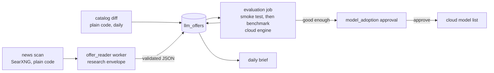

# Job 1 — Free LLM Offers: Feature Spec

> **Status: Built** (2026-10-20). First slice of
> [Jarvis and its workers](../design/11_persona_roster_plan.md): it builds the research
> envelope, workers, templates, the adoption approval, and per-provider quotas and terms —
> each only as far as this job needs.
>
> **Changed while building, from live runs:**
> - The offer reader gets **no tools**: plain code fetches the pages (safe_fetch) and the
>   worker only reads the text it is handed — more reliable, fewer calls, and a hostile page
>   has nothing to steer.
> - **Reasoning off for extraction.** Free reasoning models given a dense real page spent the
>   whole output budget (8,000 of 8,000 tokens) thinking and returned nothing; with
>   OpenRouter's `reasoning: {enabled: false}` the same models returned 14–17 offers in
>   40–50 s (`resilient_llm.reasoning_off`, template field `reasoning`).
> - **NAT64.** This host's DNS answers with `64:ff9b::/96` addresses, which the safe fetcher
>   counted as private — it blocked github.com, reddit.com and most of the web for every
>   page fetch, not only this job. Such an address is now judged by its embedded IPv4.
> - **News offers are information**, not evaluation candidates: they rarely name a model id
>   we can call. Status `noted` (we hold a key for the provider) or `needs_signup`. Only
>   catalog models are evaluated. One offer per provider and kind (`provider_key` merges
>   "Groq Cloud"/"Groq", "Google AI Studio"/"Gemini"); later pages fill unknown terms.
> - The first catalog run is a **baseline** (18 free OpenRouter models on 2026-10-20), not
>   18 "new" offers.
> - Eval: the reader passes on both free models (all 4 offers, none invented, 9/9 terms).

## Goal

Find new free LLM models, free tiers, credits and promotions as they appear; evaluate the ones
life-graph can already reach; and offer the good ones to the owner as an approval with the
results attached. No manual step between "a new free model exists" and "here is its score,
adopt it?".

## User stories and acceptance criteria

**US-1 New free models are found the day they appear.**
- **AC-1.1** GIVEN yesterday's OpenRouter catalog snapshot WHEN today's catalog lists a `:free`
  model that was not in it THEN an offer `{provider: openrouter, kind: free_model, model_id,
  source: catalog_diff}` exists with status `new`. *(test: `test_catalog_diff_finds_new_free_models`)*
- **AC-1.2** GIVEN a `:free` model that was in yesterday's snapshot WHEN it is missing today THEN
  its offer becomes `gone`, and if it was adopted it is dropped from the cloud model list and
  the owner is notified. *(test: `test_catalog_diff_marks_gone_and_drops_adopted`)*
- **AC-1.3** GIVEN an NVIDIA key WHEN the NVIDIA catalog is read THEN its models are diffed the
  same way (`provider: nvidia_nim`). Without a key the NVIDIA step is skipped, not failed.
  *(test: `test_nvidia_catalog_needs_a_key`)*
- **AC-1.4** The catalog diff is plain code: no model call. *(test: asserts no LLM call)*

**US-2 Offers in the news are read and recorded.**
- **AC-2.1** GIVEN the news queries (e.g. "free LLM API", "free tier credits LLM") WHEN the scan
  runs THEN candidate URLs come from SearXNG (plain code), already-seen URLs are dropped, and at
  most `offers_max_pages` (8) new pages are read per run. *(test: `test_news_scan_dedups_and_caps`)*
- **AC-2.2** GIVEN a page WHEN the `offer_reader` worker reads it THEN it returns, per offer:
  provider, kind (`free_tier | credits | promo | free_model`), model if named, limits, expiry,
  needs_signup, needs_card, trains_on_prompts, commercial_use (each `true|false|unknown`), and the
  source URL — or nothing if the page holds no offer. *(eval: frozen pages, §Eval)*
- **AC-2.3** An offer whose source URL was not fetched in that run is discarded.
  *(test: `test_offers_without_a_fetched_source_are_dropped`)*
- **AC-2.4** An offer for a provider we have no key for is recorded as `needs_signup`, with what
  the owner must do. *(test)*

**US-3 Reachable offers are evaluated automatically.**
- **AC-3.1** GIVEN an offer with status `new` whose model we can call (a key exists, model is
  free) WHEN the evaluation job runs THEN it first makes one tool-call smoke test; a model that
  cannot make a correct tool call is `failed` with that reason and costs nothing more.
  *(test: `test_smoke_failure_stops_evaluation`)*
- **AC-3.2** A model that passes the smoke test runs the coding benchmark
  (`evals/driver_tasks.yaml`, cloud engine) and its result — passed/total, honest/total, average
  seconds, edits ok/refused — is stored on the offer. *(test: benchmark runner is called with
  `cloud:<model_id>` and its rows are summarised)*
- **AC-3.3** At most `offers_max_evals_per_day` (2) benchmarks run per day, and none runs while
  the provider's daily quota is over 80%. *(test)*
- **AC-3.4** Evaluation never uses the GPU: cloud engine only. *(test: engine is `cloud:`)*

**US-4 Good models are offered for adoption; the owner decides.**
- **AC-4.1** GIVEN a benchmark result with passed ≥ 5/6 and average ≤ 300 s WHEN it is better
  than the weakest model in the current list (by passed, then honest, then speed), or the list has
  fewer than 4 models THEN a `model_adoption` approval is filed with the results and the offer's
  terms. Otherwise the offer is `passed` without an approval. *(test)*
- **AC-4.2** Approving it adds the model to the free cloud model list in score order (effective
  without a restart); rejecting it marks the offer `rejected` and it is never proposed again.
  *(test: `test_adoption_approval_updates_the_cloud_list`)*
- **AC-4.3** Nothing is ever adopted without an approval. *(test)*

**US-5 Providers are used within their limits and terms.**
- **AC-5.1** Every completion through the resilient chain counts against its provider's daily
  quota (`provider_daily_limits`, e.g. openrouter 900); a provider at its limit is skipped like a
  model in cooldown until the next UTC day. *(test: `test_provider_over_quota_is_skipped`)*
- **AC-5.2** Each offer stores the terms the reader found (trains_on_prompts, commercial_use) and
  the approval shows them. *(test)*

**US-6 The research envelope is enforced, not requested.**
- **AC-6.1** A research worker gets only the envelope's tools (`web_search`, `browse_web`,
  `get_current_datetime`, `calculator`), whatever its template asks. *(test)*
- **AC-6.2** A research worker runs only on a free cloud model or the local model, never a paid
  one; failover stays within those. *(test)*
- **AC-6.3** Every brief that goes to a cloud model passes the scrub first: secrets (existing
  `redaction.redact`) and personal details — phone numbers, email addresses, PAN, Aadhaar, card
  and bank account numbers, IFSC. *(test: `test_scrub_hides_personal_details`)*
- **AC-6.4** A worker's output is returned as **untrusted data** (marked, never executed, never
  fed back as instructions); the offer reader's output is parsed as JSON and validated, and
  anything else is dropped. *(test)*
- **AC-6.5** A worker has a budget: at most 12 tool calls and 180 s; over budget it stops and
  returns what it has. Workers cannot create workers. *(test)*

**US-7 The owner sees what was found.**
- **AC-7.1** New offers, evaluations and gone models appear in the daily brief under "Free LLM
  offers" (only what changed since the last brief). *(test)*
- **AC-7.2** `GET /api/v1/llm-offers` lists offers with status, terms and evaluation;
  `POST /api/v1/llm-offers/{id}/evaluate` queues one now. *(integration test)*

## Design



### Data

```sql
CREATE TABLE llm_offers (
    id            UUID PRIMARY KEY DEFAULT gen_random_uuid(),
    tenant_id     TEXT NOT NULL,
    dedup_key     TEXT NOT NULL,           -- provider|model_id, else the normalised source URL
    provider      TEXT NOT NULL,           -- openrouter, nvidia_nim, groq, ...
    model_id      TEXT,                    -- LiteLLM id when known: openrouter/x/y:free
    kind          TEXT NOT NULL,           -- free_model | free_tier | credits | promo
    title         TEXT NOT NULL,
    summary       TEXT,
    source        TEXT NOT NULL,           -- catalog_diff | news | manual
    source_url    TEXT,
    terms         JSONB NOT NULL DEFAULT '{}',  -- limits, expires_on, needs_signup, needs_card,
                                                -- trains_on_prompts, commercial_use
    status        TEXT NOT NULL DEFAULT 'new',  -- new | queued | evaluating | passed | failed |
                                                -- adopted | rejected | gone (catalog models);
                                                -- noted | needs_signup (news offers)
    evaluation    JSONB NOT NULL DEFAULT '{}',  -- smoke, passed, total, honest, avg_s, ran_at
    first_seen_at TIMESTAMPTZ NOT NULL DEFAULT now(),
    last_seen_at  TIMESTAMPTZ NOT NULL DEFAULT now(),
    updated_at    TIMESTAMPTZ NOT NULL DEFAULT now(),
    UNIQUE (tenant_id, dedup_key)
);
CREATE INDEX ix_llm_offers_tenant_status ON llm_offers (tenant_id, status);

CREATE TABLE llm_catalog_snapshots (
    id        UUID PRIMARY KEY DEFAULT gen_random_uuid(),
    provider  TEXT NOT NULL,
    taken_at  TIMESTAMPTZ NOT NULL DEFAULT now(),
    model_ids JSONB NOT NULL               -- the free model ids seen, sorted
);
```

Catalog snapshots are global (a public catalog, no tenant data); offers are per tenant.

### Workers (the first use of `spawn_worker`)

`services/workers.py`:

```python
ENVELOPES = {
    "research": Envelope(
        tools={"web_search", "browse_web", "get_current_datetime", "calculator"},
        models="free_cloud_or_local",   # never paid; failover within these (only_models)
        scrub_brief=True,               # secrets + personal details before a cloud call
        max_tool_calls=12, timeout_s=180,
    ),
}

async def run_worker(envelope: str, template: str, inputs: dict, *, tenant_id: str) -> WorkerResult:
    """Run one worker: brief from the template and inputs, tools = template ∩ envelope,
    model chosen within the envelope, output returned as untrusted data."""
```

Templates live in `services/worker_templates.py` as data (name, envelope, brief template,
tools, output schema). Job 1 adds one: **`offer_reader`** — "read these pages; for each LLM offer
on them return the fields of AC-2.2 as a JSON array; [] if none". The catalog diff, news scan
and evaluation are plain code, not workers.

### Evaluation

`services/model_eval.py` wraps the existing benchmark (`scripts/bench_drivers.py` → a callable
`run_benchmark(engine, tasks)`), plus a one-call smoke test ("call add(2, 3)"). Runs in the ARQ
worker after the catalog diff, at most 2 a day.

### Router additions

- `provider_daily_limits` (JSON setting); per-provider counters in Redis
  (`lg:quota:<provider>:<yyyymmdd>`), incremented per attempt in `resilient_llm`; a provider at its
  limit is skipped like a cooling model.
- The cloud model list = `dev_cloud_models` + adopted offers (score order), cached in-process and
  refreshed when an adoption is approved.

### Schedule

| Job | When |
|---|---|
| catalog diff (OpenRouter, NVIDIA) | daily 21:30 UTC (03:00 IST) |
| news scan + offer reader | every 6 h |
| evaluations | after the catalog diff; max 2/day |

### API

- `GET /api/v1/llm-offers?status=` → `{data: [Offer]}`
- `POST /api/v1/llm-offers/{id}/evaluate` → `{data: Offer}` (status `evaluating`)
- Approval kind `model_adoption` through the existing approvals API.

## Eval (the job's own measure)

`evals/llm_offers/`: two frozen OpenRouter catalog snapshots with the expected diff, and 8 saved
offer pages (4 real offers, 2 marketing pages without an offer, 2 unrelated) with the expected
fields. **Pass:** the diff is exact; the reader finds all 4 offers with provider and kind right,
reports none on the other 4, and gets ≥ 75% of the terms fields right. Run against each model the
reader may use before it is relied on.

## Tasks

| # | Task | Effort |
|---|---|---|
| 1 | Migration 050: `llm_offers`, `llm_catalog_snapshots`; models | S |
| 2 | Personal-detail scrub (`services/scrub.py`) + tests | S |
| 3 | `services/workers.py`: envelope, `run_worker`, untrusted output, budget; tests | M |
| 4 | `offer_reader` template + output validation; frozen-page eval | M |
| 5 | Catalog diff (OpenRouter, NVIDIA) + snapshots; gone/drop logic | S |
| 6 | News scan (SearXNG queries, dedup, cap) → offer_reader | S |
| 7 | `model_eval.py`: smoke test + benchmark wrapper; adoption criteria | M |
| 8 | `model_adoption` approval: apply → cloud list; rejection memory | S |
| 9 | Provider quotas in resilient_llm | S |
| 10 | API, ARQ jobs, daily-brief section | S |
| 11 | STATE.md regenerated; live run on the real catalog | S |
